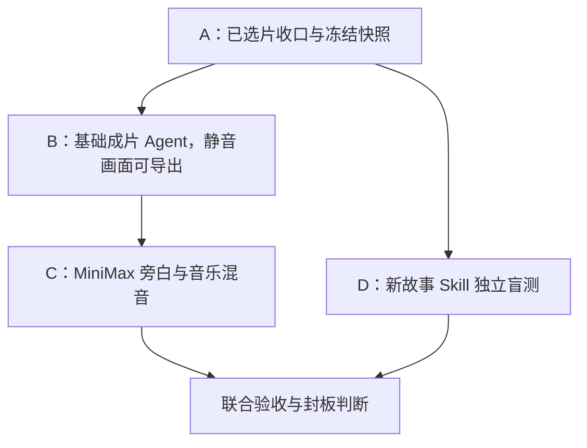

# Phase 44｜基础成片 Agent 与视频 Skill 盲测：总控路线

版本：2026-09-30。供 zcode 依次执行。输入基线：`PHASE43_REPAIR_SKILL_BLINDTEST_REPORT.md`；**该报告是证据索引，仓库状态和用户评审须由执行端重新核验**。

## 一、判断与目标

现在应开始做基础成片 Agent，同时完成原视频 Skill 的收尾和盲测。画面生产已经能提供一批可用镜头；继续只在单镜上反复打磨，不能验证“从多个镜头到一部可观看短片”的最后一段流程。成片 Agent 的第一版只做四件事：读取已选版本、按叙事顺序剪接、在合适位置放旁白、铺一条连续背景音乐并合理混音。它不重新生成视频，也不自行替用户选择有争议的镜头。

对架构的建议是**一个后期/成片专业 Agent + 确定性的时间线和渲染工具**。Agent 判断叙事节奏、旁白文案与落点；工具负责素材解析、版本检查、时间计算、音频混合和导出。先做可用的非线性剪辑最小闭环，不建复杂轨道编辑器、唇形同步、多角色配音或新的 Agent 层级。名称以仓库已有命名和 ownership 为准，暂称 `Assembly Agent`，不要为了名称重构现有模块。

## 二、报告中的已知状态与证据边界

| 项目 | 报告记录的状态 | 本阶段动作 |
|---|---|---|
| 视频 Skill | v1.3.0，报告称 49 项锚定测试通过 | 核验提交、注册、加载及真正执行轨迹；不把文档通过视作盲测通过 |
| 《雨灯归航》 | 13 镜中多数已锁定 | 核验 `s01_c04`、`s02_c02` 两笔 set-final 回拨；`s02_c03` 恢复开门动作并由用户终审 |
| 新故事夹具 | 《晨露快递》Look、场景、道具已准备且获用户批准 | 冻结后从全新 Producer 会话通过正式入口运行；报告明确说**尚未启动** |
| 本地候选版本 | 报告称新一代会自动成为 final、本地 mp4 覆盖旧代 | 成片只能读取已裁定的版本及可核验的媒体快照，禁止靠“最新文件”猜测 |
| 音频 | 用户已有 MiniMax 语音 API | 执行端先审计现有密钥接入与服务封装，再对接；不在文档中假设其账户、模型、费用和 voice_id |

报告所写的提交哈希、版本 ID、脚本、端口、配额数字都是**移交线索**，不是本文件独立核验的仓库事实。若当前状态已变化，以实际仓库、业务回执、评审记录和用户最后选择为准；记录差异，不照抄旧值执行。

## 三、两条主线及合流

若 zcode 有并行工作能力，B 与 C 可在 A 交出只读快照后并行；D 的接口调查和假数据测试可与 B 同时开展，但真实接线须以 B 的时间线契约为准。C 的受测 Agent 不可接触 A 的逐镜答案或 B 的剪辑方案。共享同一仓库时各线用独立工作树或分支，不并写 canonical、正式 Skill 和同一项目评审文件；合流前审查差异与回归。

### 各批次文件

| 批次 | 文件 | 可开始条件 | 必须交付 |
|---|---|---|---|
| A：基线与收尾 | `PHASE44_A_选片收口与冻结.md` | 立即 | 旧片正式版本、媒体可用性、冻结清单和未裁定项 |
| B：成片骨架 | `PHASE44_B_基础成片Agent.md` | A 的只读快照 | Agent、时间线 manifest、无旁白的可播放成片、回执和预览 |
| C：声音链路 | `PHASE44_C_旁白音乐与混音.md` | B 的时间线契约；前期审计可提前 | MiniMax TTS、连续音乐、混音后的成片与可替换的分轨 |
| D：Skill 盲测 | `PHASE44_D_新故事盲测与联合验收.md` | A 冻结 Skill/资产 | 新会话盲测证据、隔离故障演练、与成片线联合验收 |

执行时**每完成一批交一份独立报告**，后批读取前批报告与真实产物；不要在未验收的前批上宣称全阶段完成。用户需要看的画面或声音提供短片/评审页及对应问题，不以模型自动评分代替用户审美裁定。可以先做不依赖用户反馈的准备、代码和定向测试；遇到影响最终选片或作品审美的分歧才保留候选等待用户看片。

## 四、共同契约与禁止混淆

1. 项目事实来自 canonical；生成候选、用户已批准、正式 final、成片使用版本是四种不同状态。成片 manifest 固定版本 ID、素材哈希/不可变副本、来源和对应时间线位置。成片输出是派生版本，不反写 Shot 的 `final_video`。
2. 自动设 final 的既有行为不等于用户批准。执行前后核对 final 指针和评审记录，记录发生的自动前移与回拨。
3. 视频制作 Skill 与成片 Agent 各自有 ownership。盲测失败先分为“选择方法错 / Binding 或工具错 / 请求正确但随机候选不好 / 审美待人评”，再决定改代码、Skill 还是保留边界。
4. Agent 给出剪辑意图，确定性编译器把意图投影成时间线。真实导出应可复现：同一输入快照、时间线和渲染配置能复跑，外部 TTS 结果要缓存为带哈希的音频资产。
5. 公开临时 URL 不是长期档案。下载、校验、落入项目受管媒体体系，记录原始 URL/回执与本地资产关系；失效时报缺失，不静默改用最新镜头。
6. 任何音频 API 的请求/响应日志不得含密钥或完整敏感配置。真实调用前确认用户现有 API 的额度及业务策略；小样本先行、可重试但不得无界重复付费。

## 五、阶段出口

基础成片 Agent 的第一版通过：能由冻结的已选镜头自主提出可审查的时间线；导出从头到尾可播放的画面；旁白文本及声线受控、音乐连续且旁白清晰；单镜替换后只需重编成片，仍能追溯旧版；用户观看并接受至少一部短片。视频 Skill 的“当前范围可封板”需独立满足：旧片选片与依赖闭合，冻结版本新会话在新故事中自主决策，真实回执和逐镜画面齐备，故障恢复可解释，用户看片认可。两者可分别标记通过，不能互相代替。

## 六、外部技术依据（实现细节最终以仓库为准）

- FFmpeg concat demuxer 要求各素材流结构、编解码器和 time base 兼容；不满足时应规范化重编码或用滤镜时间线。https://ffmpeg.org/ffmpeg-formats.html#concat-1
- FFmpeg 提供 `amix`、`sidechaincompress`、`loudnorm` 等混音工具，需以实际音轨试听和测量验收。https://ffmpeg.org/ffmpeg-filters.html
- MiniMax 官方 T2A v2 文档有非流式输出及 `voice_setting`、`audio_setting`、`trace_id`；响应 `data` 可能为空，返回 URL 有时效，接入须验证响应和持久化音频。https://platform.minimax.io/docs/api-reference/speech-t2a-http
